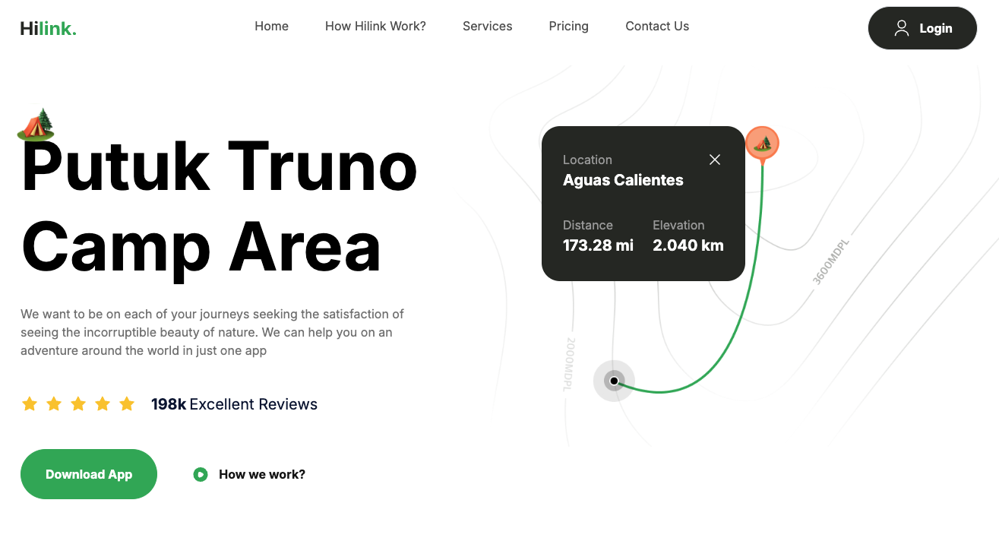

# 🏕️ Hilink — Camping & Outdoor Adventure App

A modern, responsive camping and outdoor travel landing page built with **Next.js 13**, **TypeScript**, and **Tailwind CSS**. Designed to help hikers and travelers discover trails, use offline maps, and schedule outdoor adventures with friends.

🔗 **Live Demo:** [hilinkcampapp.netlify.app](https://netlify.app)



---

## 🛠️ Tech Stack


---

## ✨ Key Features

- **Appealing Hero & Camp Showcase:** Engaging visual presentation with interactive trail cards and community ratings.
- **Step-by-Step Guide:** Clear walkthrough explaining how Hilink guides hikers without an internet connection.
- **Core Features Grid:** Highlights offline maps, adventure scheduling, augmented reality navigation, and monthly new locations.
- **Mobile App Download CTA:** Dedicated call-to-action section for iOS and Android users.
- **Fully Responsive & Performance Optimized:** Built mobile-first with Tailwind CSS and self-hosted fonts via `next/font/google`.

---

## 📂 Project Structure

```text
├── app/
│   ├── globals.css       # Custom Tailwind utility classes & global styles
│   ├── layout.tsx        # Root layout with Next.js Font optimization, Navbar & Footer
│   └── page.tsx          # Main landing page assembling all sections
├── components/           # Reusable UI components (Hero, Camp, Guide, Features, GetApp, Navbar, Footer, Button)
├── constants/            # Centralized data for navigation links, features, and footer links
└── public/               # Static assets, SVG icons, and illustrations
```

---

## 🚀 Getting Started

Follow these steps to run the project locally on your machine:

### 1. Clone the repository
```bash
git clone https://github.com
cd Camp-App
```

### 2. Install dependencies
```bash
npm install
```

### 3. Start the development server
```bash
npm run dev
```

Open [http://localhost:3000](http://localhost:3000) in your browser to view the application.

---

## 📜 Available Scripts

- `npm run dev` — Starts the local development server.
- `npm run build` — Creates an optimized production build.
- `npm run start` — Runs the built application in production mode.
- `npm run lint` — Checks code quality and Next.js best practices with ESLint.
